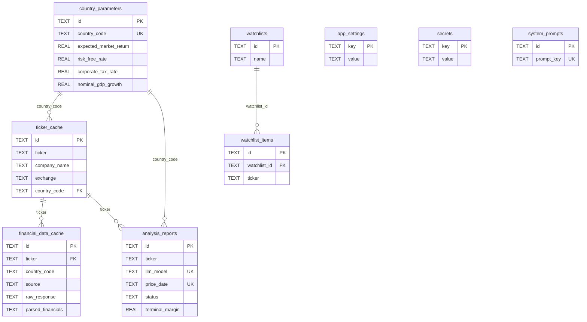

# Database Design: Stocksy Desktop

## 1. Overview and Design Principles

Stocksy Desktop uses a local SQLite database (single file, WAL mode) for fast, private, offline-capable data storage.

**Design Principles:**
1. **Single User** — No `user_id` columns. All data belongs to the local user.
2. **Multi-Country** — India, US, UK, Australia from day one. Country parameters are pre-seeded and user-editable.
3. **Yahoo Finance Primary** — Free, global coverage. No API budget tracking needed.
4. **Report Versioning** — Each analysis run creates a new record keyed by `ticker + llm_model + price_date`. Supports comparison by date and by model.
5. **No Manual Fallback** — Yahoo Finance is the sole source; insufficient data (`<3` years / non-positive price/mcap / 2-consecutive negative `operating_income`) maps to `financial_data_cache` miss → ephemeral `failure` (`error_*`, queue `Failed`, not persisted). No popup or JSON import.
6. **Percentages as Real Decimals** — All rates stored as decimals (e.g., 0.07067 for 7.067%, not 7.067).

**Tables: 9 tables + 1 FTS virtual table**

---

## 2. Entity-Relationship Diagram



---

## 3. Table Schemas

### 3.1. country_parameters

Stores macroeconomic parameters per country. **Equity Risk Premium is computed dynamically** as `expected_market_return - risk_free_rate`.

```sql
CREATE TABLE country_parameters (
    id TEXT PRIMARY KEY,
    country_code TEXT UNIQUE NOT NULL,           -- 'IN', 'US', 'GB', 'AU'
    country_name TEXT NOT NULL,
    currency_code TEXT NOT NULL,                 -- 'INR', 'USD', 'GBP', 'AUD'
    currency_symbol TEXT,                        -- '₹', '$', '£', 'A$'
    expected_market_return REAL NOT NULL,         -- decimal (e.g., 0.16 for 16%)
    risk_free_rate REAL NOT NULL,                -- 10-yr govt bond yield (decimal)
    -- equity_risk_premium = expected_market_return - risk_free_rate (COMPUTED, not stored)
    corporate_tax_rate REAL NOT NULL,             -- decimal
    nominal_gdp_growth REAL NOT NULL,             -- decimal
    yahoo_ticker_suffix TEXT,                    -- '.NS', '.BO', '', '.L', '.AX'
    reference_urls TEXT,                         -- JSON: URLs for periodic data refresh
    is_active INTEGER DEFAULT 1,
    updated_at TEXT DEFAULT (datetime('now')),
    created_at TEXT DEFAULT (datetime('now'))
);
```

**Computed column usage in queries:**
```sql
-- Get equity risk premium for a country
SELECT
    expected_market_return - risk_free_rate AS equity_risk_premium,
    *
FROM country_parameters
WHERE country_code = 'IN';
```

---

### 3.2. system_prompts

Task-specific LLM prompts for different stages of DCF analysis. The implementation seeds **6 modular modules per D9** (see §5), stored as distinct rows and concatenated at runtime into a single system prompt.

```sql
CREATE TABLE system_prompts (
    id TEXT PRIMARY KEY,
    prompt_key TEXT UNIQUE NOT NULL,             -- 'role_and_abort_protocol', 'validation_and_search', 'growth_and_fcf', 'confidence_scoring', 'narrative_and_risks', 'json_schema'
    prompt_name TEXT NOT NULL,                   -- user-facing label (e.g., 'Role & Abort Protocol')
    prompt_text TEXT NOT NULL,                   -- the actual system prompt text
    description TEXT,                            -- what this prompt is used for
    is_active INTEGER DEFAULT 1,
    version INTEGER DEFAULT 1,
    updated_at TEXT DEFAULT (datetime('now')),
    created_at TEXT DEFAULT (datetime('now'))
);
```

---

### 3.3. app_settings

Generic key-value store for application preferences and configuration.

```sql
CREATE TABLE app_settings (
    key TEXT PRIMARY KEY,
    value TEXT NOT NULL,
    category TEXT,                               -- 'llm', 'search', 'scrape', 'display', 'dcf'
    updated_at TEXT DEFAULT (datetime('now'))
);
```

---

### 3.4. secrets

Stores XOR-obfuscated API keys. Kept separate from `app_settings` so that a DB dump never exposes plaintext credentials. The Rust module `keyring_store.rs` manages this table.

```sql
CREATE TABLE IF NOT EXISTS secrets (
    key   TEXT PRIMARY KEY NOT NULL,
    value TEXT NOT NULL    -- XOR-obfuscated + base64-encoded ciphertext
);
```

**Obfuscation scheme:** machine-derived XOR key constructed from `"stocksy-desktop:{HOME}:{USER}"`, repeated to 256 bytes. The plaintext is XOR'd byte-by-byte then base64-encoded. On read the process is reversed. This prevents plaintext keys sitting in the SQLite file; it is **obfuscation, not cryptographic encryption**.

**Managed keys (`SECRET_KEYS` constant — 7 entries, `src-tauri/src/keyring_store.rs:11`):**

| Key | Provider |
| :--- | :--- |
| `llm.anthropic.api_key` | Anthropic |
| `llm.deepseek.api_key` | DeepSeek |
| `llm.openai.api_key` | OpenAI |
| `llm.kimi.api_key` | Kimi (Moonshot) |
| `llm.custom.api_key` | Custom / Local |
| `search.tavily_key` | Tavily |
| `search.scrapingdog_key` | ScrapingDog |

**Invariant enforced by test `seeds_never_contain_secret_keys`:** none of the 7 keys above may ever appear in `app_settings`. (Former `search.brave_key` / custom-provider keys were replaced by the bundled Tavily + ScrapingDog pair — not seeded.)

---

### 3.5. ticker_cache

Pre-seeded ticker list per country for instant typeahead. **Only** `ticker, company_name, exchange, country_code` are stored (plus `id`/`created_at`). All market/financial attributes (beta, market cap, financial-services flag, etc.) live in `financial_data_cache` / `analysis_reports` and are fetched on analysis, not at seed.

```sql
CREATE TABLE ticker_cache (
    id TEXT PRIMARY KEY,
    ticker TEXT NOT NULL,
    company_name TEXT,
    exchange TEXT,
    country_code TEXT NOT NULL,
    created_at TEXT DEFAULT (datetime('now')),
    FOREIGN KEY (country_code) REFERENCES country_parameters(country_code),
    UNIQUE(ticker, country_code)
);

CREATE INDEX idx_ticker_cache_country ON ticker_cache(country_code);
CREATE INDEX idx_ticker_cache_name ON ticker_cache(company_name);
```

---

### 3.6. financial_data_cache

Caches Yahoo Finance financial data (or user-provided manual data). The `parsed_financials` JSON contains 5 years of annual data including TTM — no separate TTM column needed.

```sql
CREATE TABLE financial_data_cache (
    id TEXT PRIMARY KEY,
    ticker TEXT NOT NULL,
    country_code TEXT NOT NULL,
    source TEXT NOT NULL DEFAULT 'yahoo',        -- 'yahoo' only (no 'manual_input' path)
    raw_response TEXT NOT NULL,                  -- complete JSON from Yahoo extraction
    parsed_financials TEXT,                      -- JSON: 5-year annual data + TTM (normalized: TTM first row, last 4 fiscal years b.cmp(a) — see yahoo/transform.rs:149)
    fetch_date TEXT NOT NULL,                    -- when we fetched this data (skip upsert when reusing cached payload for different-model analysis)
    created_at TEXT DEFAULT (datetime('now')),
    FOREIGN KEY (country_code) REFERENCES country_parameters(country_code),
    UNIQUE(ticker, country_code)
);

CREATE INDEX idx_fin_cache_ticker ON financial_data_cache(ticker);
```

> **Removed from previous version**: `ttm_data` (included in `parsed_financials`), `company_name`, `sector`, `industry` (available in `ticker_cache`), `price_date` (moved to `ticker_cache`).

---

### 3.7. analysis_reports

The **core table**. Each row is one complete DCF analysis run. Multiple rows per ticker expected (different dates, different models). Includes error status for failed analyses.

```sql
CREATE TABLE analysis_reports (
    id TEXT PRIMARY KEY,
    ticker TEXT NOT NULL,
    company_name TEXT NOT NULL,
    exchange TEXT,
    country_code TEXT NOT NULL,
    sector TEXT,
    industry TEXT,
    market_cap_category TEXT,                    -- 'mega', 'large', 'mid', 'small', 'micro'
    price_date TEXT NOT NULL,                    -- stock price date from Yahoo Finance
    analysis_date TEXT NOT NULL,                 -- when this analysis was actually run
    is_primary INTEGER DEFAULT 0,               -- user-pinned report for screener display

    -- Status (not all stocks can run DCF successfully)
    status TEXT NOT NULL DEFAULT 'completed',    -- 'completed', 'error_no_data', 'error_not_profitable',
                                                -- 'error_llm_failed', 'error_insufficient_history'
    error_message TEXT,                          -- human-readable error description (null if success)

    -- Price snapshot at time of analysis
    current_price REAL,
    market_cap REAL,
    currency_code TEXT,

    -- Core DCF outputs (null if status != 'completed')
    base_case_fair_value REAL,
    weighted_fair_value REAL,
    bull_case_fair_value REAL,                  -- optimistic scenario FV (v2, SCHEMA_002)
    bear_case_fair_value REAL,                  -- pessimistic scenario FV (v2, SCHEMA_002)
    valuation_gap_pct REAL,
    valuation_verdict TEXT,                      -- 'undervalued', 'fairly_valued', 'overvalued'

    -- WACC
    wacc REAL,
    cost_of_equity REAL,
    cost_of_debt_after_tax REAL,
    raw_beta REAL,
    blume_adjusted_beta REAL,
    terminal_growth_rate REAL,
    terminal_margin REAL,                        -- terminal operating margin

    -- Risk/Reward
    upside_pct REAL,
    downside_pct REAL,
    risk_reward_ratio REAL,
    risk_reward_label TEXT,                      -- 'Excellent', 'Very Good', 'Good', 'Balanced', 'Higher Risk'

    -- Scenarios (JSON: array of 3 scenario objects)
    scenarios TEXT,                              -- JSON: [{scenario_name, probability, revenue_cagr,
                                                --   terminal_margin, wacc, terminal_growth, fair_value,
                                                --   vs_current_price_pct, narrative, supporting_evidence}]

    -- Sensitivity (JSON: 3×3 matrix = 9 cells)
    -- WACC adjusted by -0.5%, 0%, +0.5% × Growth adjusted by -0.5%, 0%, +0.5%
    sensitivity_matrix TEXT,                     -- JSON: [{wacc_level, growth_level, wacc_value,
                                                --   growth_value, fair_value, pct_change_from_base,
                                                --   is_base_case, is_model_stable}]

    -- Confidence (JSON: 5 dimensions) — score/level are clamped LLM outputs (v2 fix, see §7)
    confidence_score REAL,                       -- 0-100, from confidence_details.overall_score (clamped 30/30/20/15/5)
    confidence_level TEXT,                       -- 'high' ≥70, 'moderate' 40-69, 'low' <40
    confidence_details TEXT,                     -- JSON: {overall_score, overall_level, dimensions:{cash_flow_predictability, competitive_position,
                                                --   financial_health, industry_visibility, management_quality — each with score, max_score, reasoning}}

    -- AI narrative sections (markdown)
    ai_business_context TEXT,
    ai_historical_performance TEXT,
    ai_growth_projections TEXT,
    ai_opportunities_risks TEXT,
    ai_investment_perspective TEXT,

    -- Assumptions used (JSON — NOT modified by interactive overrides)
    dcf_assumptions TEXT,                        -- JSON: all assumptions (growth rates, margins, tax, capex, etc.)

    -- Country params snapshot (JSON — what values were used for this analysis)
    country_params_snapshot TEXT,

    -- Web search context (JSON: URLs and snippets used by AI)
    search_sources TEXT,

    -- Sensitivity base parameters (JSON — needed for local recomputation)
    sensitivity_base_parameters TEXT,            -- JSON: {wacc, terminal_growth, terminal_margin,
                                                --   base_fair_value, fcf_year_5, shares_outstanding,
                                                --   latest_cash, latest_debt}

    -- LLM metadata (part of unique identity for model comparison)
    llm_provider TEXT NOT NULL,                  -- 'anthropic', 'deepseek', 'openai', 'kimi', 'custom' (D1 4+1)
    llm_model TEXT NOT NULL,                     -- 'claude-3-7-sonnet-20250219', 'gpt-4o', 'deepseek-reasoner', 'moonshot-v1-auto', etc.
    llm_thinking_tokens INTEGER,
    llm_output_tokens INTEGER,
    llm_duration_ms INTEGER,

    -- User annotations
    is_favorite INTEGER DEFAULT 0,
    user_notes TEXT,
    tags TEXT,                                   -- JSON array of strings

    created_at TEXT DEFAULT (datetime('now')),
    updated_at TEXT DEFAULT (datetime('now')),

    FOREIGN KEY (country_code) REFERENCES country_parameters(country_code),
    UNIQUE(ticker, llm_model, price_date)
);

CREATE INDEX idx_reports_ticker ON analysis_reports(ticker);
CREATE INDEX idx_reports_price_date ON analysis_reports(price_date);
CREATE INDEX idx_reports_model ON analysis_reports(llm_model);
CREATE INDEX idx_reports_primary ON analysis_reports(is_primary);
CREATE INDEX idx_reports_favorite ON analysis_reports(is_favorite);
CREATE INDEX idx_reports_verdict ON analysis_reports(valuation_verdict);
CREATE INDEX idx_reports_sector ON analysis_reports(sector);
CREATE INDEX idx_reports_country ON analysis_reports(country_code);
CREATE INDEX idx_reports_status ON analysis_reports(status);
```

---

### 3.8. Watchlist Tables

```sql
CREATE TABLE watchlists (
    id TEXT PRIMARY KEY,
    name TEXT NOT NULL,
    description TEXT,
    created_at TEXT DEFAULT (datetime('now')),
    updated_at TEXT DEFAULT (datetime('now'))
);

CREATE TABLE watchlist_items (
    id TEXT PRIMARY KEY,
    watchlist_id TEXT NOT NULL,
    ticker TEXT NOT NULL,
    country_code TEXT NOT NULL,
    notes TEXT,
    target_price REAL,
    added_at TEXT DEFAULT (datetime('now')),
    FOREIGN KEY (watchlist_id) REFERENCES watchlists(id) ON DELETE CASCADE,
    FOREIGN KEY (country_code) REFERENCES country_parameters(country_code),
    UNIQUE(watchlist_id, ticker, country_code)
);
```

---

### 3.9. report_search_fts (Virtual Table)

Full-text search index for searching within generated reports.

```sql
CREATE VIRTUAL TABLE report_search_fts USING fts5(
    ticker,
    company_name,
    sector,
    industry,
    content='analysis_reports',
    content_rowid='rowid'
);
```

---

## 4. Report Versioning Strategy

Reports are uniquely identified by `(ticker, llm_model, price_date)`. The `is_primary` flag allows the user to manually pin a preferred report for each ticker in the screener view.

### Example 1: Temporal Comparison
- **Jan 15**: User analyzes RELIANCE.NS with Claude → Report #1 (auto-set `is_primary=1`).
- **Mar 20**: User re-analyzes after Q4 earnings → Report #2 (auto-set `is_primary=1`, Report #1 becomes `is_primary=0`).
- **Outcome**: Side-by-side comparison of how valuation evolved over the quarter.

### Example 2: Model Comparison
- User analyzes AAPL with Claude, GPT-4o, and Ollama Qwen 2.5 on the same day.
- 3 reports with same `price_date`, different `llm_model`.
- User manually pins their preferred analysis as `is_primary=1`.

### Example 3: Failed Analysis
- User attempts DCF on a pre-revenue startup → `status='error_not_profitable'`, `error_message='2+ consecutive years of negative operating income'`.
- Report is saved with error status but no DCF outputs. User can see why it failed.

> **Note**: Interactive assumption overrides (F2.15) are for UI exploration only and are **NOT persisted** back to `analysis_reports`. The saved report always reflects the original AI-generated analysis.

---

## 5. Pre-seeded Data

### country_parameters

All percentages as real decimals. `equity_risk_premium` is computed as `expected_market_return - risk_free_rate`.

| Country | Code | Currency | Expected Mkt Return | Risk-Free Rate | ERP (computed) | Tax Rate | GDP Growth | Yahoo Suffix |
| :--- | :--- | :--- | :--- | :--- | :--- | :--- | :--- | :--- |
| India | IN | INR ₹ | 0.16 | 0.07067 | 0.0893 | 0.30 | 0.1033 | `.NS` |
| United States | US | USD $ | 0.12 | 0.04996 | 0.0701 | 0.25 | 0.06562 | ` ` |
| United Kingdom | GB | GBP £ | 0.08 | 0.05298 | 0.0270 | 0.25 | 0.04059 | `.L` |
| Australia | AU | AUD A$ | 0.11 | 0.05292 | 0.0571 | 0.30 | 0.05251 | `.AX` |

**Reference URLs** (stored as JSON in `reference_urls` column):
```json
{
  "risk_free_rate": {
    "IN": "https://www.investing.com/rates-bonds/india-10-year-bond-yield",
    "US": "https://www.investing.com/rates-bonds/u.s.-10-year-bond-yield",
    "GB": "https://www.investing.com/rates-bonds/uk-10-year-bond-yield",
    "AU": "https://www.investing.com/rates-bonds/australia-10-year-bond-yield"
  },
  "tax_rate": "https://pages.stern.nyu.edu/~adamodar/New_Home_Page/datafile/ctryprem.html",
  "nominal_gdp_growth": {
    "IN": "https://www.ceicdata.com/en/indicator/india/nominal-gdp-growth",
    "US": "https://www.ceicdata.com/en/indicator/united-states/nominal-gdp-growth",
    "GB": "https://www.ceicdata.com/en/indicator/united-kingdom/nominal-gdp-growth",
    "AU": "https://www.ceicdata.com/en/indicator/australia/nominal-gdp-growth"
  }
}
```

### system_prompts (Pre-seeded keys — 6 modules per D9, `src-tauri/src/seeds.rs:PROMPT_ROWS`, `src-tauri/src/prompts/mod.rs:ORDER`)

**Authoritative order (user-approved, enforced in UI and stitched prompt):**
`1 role_and_abort_protocol` → `2 validation_and_search` → `3 growth_and_fcf` → `4 narrative_and_risks` → `5 confidence_scoring` → `6 json_schema`. Stored as 6 rows; runtime `stitch()` joins in that fixed order with `\n\n---\n\n`. `list_prompts` uses `ORDER BY CASE prompt_key … END` so the DB and UI always reflect this sequence (not alphabetical). `PROMPT_ROWS` insertion order matches the same sequence.

| # | prompt_key | prompt_name | Description |
| :--- | :--- | :--- | :--- |
| 1 | `role_and_abort_protocol` | Role & Abort Protocol | ValorBot identity and critical abort rules for failure cases |
| 2 | `validation_and_search` | Input Data, Tools & Search Strategy | Input JSON structure + web_search/web_scrape tool rules + country-specific search guidance |
| 3 | `growth_and_fcf` | Growth, FCF & WACC Inputs | Revenue/margin projections (Y1-2 consensus → Y3-5 GDP convergence) + terminal + FCF conversion + cyclicality |
| 4 | `narrative_and_risks` | Narrative & Risks | Business context, historical insights (single string), growth rationale, terminal math, scenario_narratives, opportunities/risks, investment perspective |
| 5 | `confidence_scoring` | Confidence Scoring | 5-dimension rubric (caps 30/30/20/15/5) with evidence-required reasoning |
| 6 | `json_schema` | Structured JSON Output | Strict output format / schema required by Rust backend (single JSON object, rates as decimals) |

**UI behavior (v2 patch):** `Settings → System Prompts` shows `1. … 6.` numbering, persists selection via `app_settings.ui.prompts_selected_key`, and refetches after Save/Restore so `version/updated_at` survive tab switches. Per-prompt **Restore defaults** reseeds that single row from `PROMPT_ROWS` (`version=1`).

> **Supersedes** earlier 4-key draft (`growth_analysis` etc.). The 6-key set is authoritative per `DECISIONS.md:D9` and `docs/design/05 §System Prompts`.

---

## 6. Feature Mapping

| Table | Approved Features |
| :--- | :--- |
| `country_parameters` | F5.2 (Country Parameters), F9.5 (Country Editor) |
| `ticker_cache` | F1.1 (Ticker Cache & Search), F1.5 (Market Cap), F1.6 (Financial Services Detection), F5.5 (Dual Search — ticker search) |
| `financial_data_cache` | F1.2 (Financial Data), F1.9 (Local Caching & Refresh) — same-model freshness via `historical_data` deep-equality (`is_same_historical_data`); no F2.16 button |
| `analysis_reports` | F5.3 (Saved Reports), F5.4 (Report Versioning), F6.2 (Screener Table), F6.11 (Stock Comparison) |
| `report_search_fts` | F5.5 (Dual Search — report search) |
| `system_prompts` | F3.6 (Configurable System Prompts), F9.9 (Prompt Editor) |
| `watchlists` + `watchlist_items` | F6.12 (Watchlists) |
| `app_settings` | F9.1, F9.3, F9.5, F9.7, Queue (LLM, AI Agent Tools incl. `search.tavily_search_url` / `scrape.tavily_extract_url` / `search.scrapingdog_*`, Country Params, Appearance, `analysis.max_parallel`); `display.*` + `search.*` + `general.*` + `ui.*` (help tab) — **28 seeded rows** (`src-tauri/src/seeds.rs:322`) — was 26. F9.6 lives on Help (D4, 4-tab guide) |
| `secrets` | F9.2 (Secure API Key Storage — XOR-obfuscated, **7** managed keys) |

---

## 7. Migrations

`src-tauri/src/db.rs` uses `MIGRATIONS = [SCHEMA_001, SCHEMA_002]` with `schema_migrations` version tracking (`UNCHECKED TRANSACTION`).

- **SCHEMA_001** — Initial 9 tables + FTS + indexes + triggers.
- **SCHEMA_002 (v2 patch)** — `ALTER TABLE analysis_reports ADD COLUMN bull_case_fair_value REAL; ADD COLUMN bear_case_fair_value REAL;` — backfills bull/bear from `scenarios` (optimistic/pessimistic). Existing installs auto-migrate on next launch; fresh installs run both migrations.

## 8. Changes from Previous Version

| Change | Reason |
| :--- | :--- |
| Added `expected_market_return` to `country_parameters` | ERP = expected_mkt_return - risk_free_rate (user review) |
| Added `reference_urls` to `country_parameters` | URLs for periodic data refresh by user |
| Updated pre-seeded values | User-provided exact values for IN/US/GB/AU |
| **Removed `industry_config` table** | Let AI determine FCF conversion; `is_financial_services` on `ticker_cache` handles main edge case |
| Added `beta`, `shares_outstanding`, `is_financial_services`, `price_date` to `ticker_cache` | Essential attributes for pre-analysis classification |
| Removed `ttm_data`, `company_name`, `sector`, `industry`, `price_date` from `financial_data_cache` | TTM in `parsed_financials`; metadata in `ticker_cache`; price_date moved to `ticker_cache` |
| Added `terminal_margin` to `analysis_reports` | Required for scenario comparison display |
| Added `status` and `error_message` to `analysis_reports` | Not all stocks can run DCF (no data, not profitable, etc.) |
| Added `sensitivity_base_parameters` to `analysis_reports` | Needed for local recomputation of sensitivity matrix |
| Sensitivity: confirmed ±0.5% (50 bps) steps from n8n production code | 3×3 = 9 combinations |
| Kept `is_primary` | For user-pinned manual report selection in screener |
| Kept `prompt_name` | User-facing display label in settings UI |
| Added `search.tavily_search_url`, `scrape.tavily_extract_url`, `search.scrapingdog_search_url`, `scrape.scrapingdog_scrape_url`, `search.active_provider`, `analysis.max_parallel`, `general.*`, `search.enabled/max_results/exclude_extensions` to `app_settings` | Bundled Tavily + ScrapingDog pair (replaces Brave/Jina), `tavily_search` `https://api.tavily.com/search`, `tavily_extract` `https://api.tavily.com/extract`, `scrapingdog_search` `https://api.scrapingdog.com/google`, `scrapingdog_scrape` `https://api.scrapingdog.com/scrape`; `seeds` 26→28. Defaults now `llm.thinking_budget 20000` (was 10000), `llm.temperature 0.3` (was 0.1), `llm.max_tokens 32000` (was 8192) with migrations `seeds.rs:476-481`. |
| | Dual backup: `.sbk` (`STOCKYBK` MessagePack via `backup.rs:4`, 7 tables) **and** `VACUUM INTO` (`db.rs:917`) | `backup_export/restore` (`.sbk`) is the app path (`commands.rs:732`); `VACUUM INTO` is the legacy/test path (`backup_vacuum_into_produces_valid_replica`) |
| **SCHEMA_002: Added `bull_case_fair_value`, `bear_case_fair_value` to `analysis_reports`** | Persist optimistic/pessimistic fair values alongside `base_case_fair_value`/`weighted_fair_value` for report/screener display |
| **Fixed `confidence_score`/`confidence_level` persistence** | `pipeline::save_success` now uses clamped `confidence_details.overall_score/level` (from `confidence_scoring` 30/30/20/15/5 → sum 0-100; high ≥70, moderate 40-69, low <40), not engine empty `0/low`; `ON CONFLICT` also updates these fields |
| **Fixed `system_prompts` ordering & persistence** | Enforced `1-6` CASE ordering in `list_prompts` + `prompts::ORDER`; UI shows `1. … 6.`, persists selection via `ui.prompts_selected_key`, refetches after Save/Restore; added per-prompt `Restore defaults` (reseed single row, `version=1`) |
