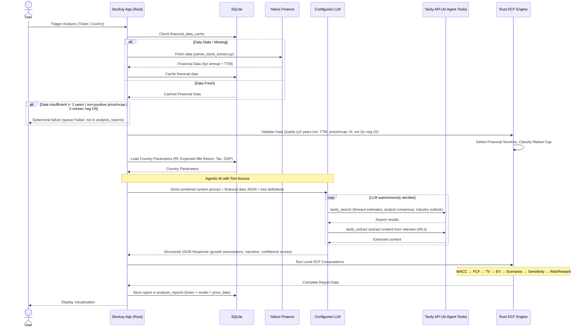

# DCF Engine and Pipeline Design

This document details the DCF calculation engine and end-to-end analysis pipeline for Stocksy Desktop. The system uses Yahoo Finance as the primary data source, supports multi-country parameters, and employs an **agentic AI pattern** where the LLM autonomously uses web search/scrape tools during analysis.

> [!NOTE]
> **Computation Split**
> - 🤖 **AI (LLM)**: Qualitative analysis, forward estimates research (via tools), growth assumptions, narrative generation, confidence scoring.
> - 🔧 **Local (Rust)**: Deterministic financial math — WACC, FCF, terminal value, EV, scenarios, sensitivity, risk/reward.
> - The AI has **tool access** and autonomously decides when to search/scrape for information.

---

## 1. Pipeline Overview

The analysis pipeline follows an **agentic pattern**: the app prepares structured financial data, sends it to the LLM with tool definitions, and the LLM autonomously researches forward estimates and generates analysis.



### Pipeline Steps

| Step | Component | Description |
| :--- | :--- | :--- |
| 1 | App | User triggers analysis for a ticker with country context |
| 2 | App → DB | Check `financial_data_cache` — use cached if fresh |
| 3 | App → Yahoo | If stale/missing, fetch from Yahoo Finance |
| 4 | App → User | If Yahoo data insufficient (<3 years / non-positive price/mcap / 2-consec neg OI), return ephemeral `failure` (queue `Failed`, not a DB row) — no popup; Yahoo is sole source |
| 5 | Rust Engine | Validate data quality (≥3 years incl. TTM; `validate_historical` logic is test-local — production is inline at `yahoo/transform.rs:200` + `engine/mod.rs:283`) |
| 6 | Rust Engine | Detect financial services firm (`is_financial_services` keyword matcher), classify market cap (country-appropriate; India threshold `/1e7` crore etc.) |
| 7 | App → DB | Load country parameters (Rf, expected market return, tax rate, GDP growth) |
| 8 | App | Prepare input JSON: company info + financial data + country params |
| 9 | App → LLM | Send combined system prompt + input JSON + **tool definitions** (tavily_search, tavily_extract) |
| 10 | **LLM (Agentic)** | LLM autonomously searches for forward estimates, analyst consensus, sector reports, management guidance. Uses tools as needed based on country/stock/industry context. |
| 11 | LLM → App | Returns structured JSON: growth projections, operating margins, narrative sections, confidence scores, opportunities/risks with sources |
| 12 | Rust Engine | Compute WACC, FCF projections, terminal value, enterprise value, equity value, fair value |
| 13 | Rust Engine | Apply scenario offsets (Optimistic/Expected/Pessimistic), compute weighted fair value |
| 14 | Rust Engine | Generate 3×3 sensitivity matrix (±0.5% WACC × ±0.5% growth) |
| 15 | Rust Engine | Compute risk/reward ratio, valuation verdict |
| 16 | Rust Engine | Validate/clamp confidence scores to max bounds |
| 17 | App → DB | Store complete report in `analysis_reports` (keyed by ticker + model + price_date) |
| 18 | App → User | Return results to frontend for visualization |

---

## 2. Agentic AI Architecture

### Tool Definitions Provided to LLM

The LLM receives tool definitions that it can call autonomously during reasoning:

| Tool (LLM name) | Bundled provider | Operation (URL from `app_settings`, editable) | Wire format |
| :--- | :--- | :--- | :--- |
| `web_search` | **Tavily** (active provider, default) | `search.tavily_search_url` (default `https://api.tavily.com/search`) | `POST {query, search_depth:"advanced", max_results 1-10, exclude_domains:[]}` → `Authorization: Bearer` |
| `web_search` | **ScrapingDog** (bundled fallback) | `search.scrapingdog_search_url` (default `https://api.scrapingdog.com/google`) | `GET ?api_key&query&advance_search=true&domain=google.com&language=en&results=` |
| `web_scrape` | **Tavily Extract** | `scrape.tavily_extract_url` (default `https://api.tavily.com/extract`) | `POST {urls:[url], query:"find forward estimates", extract_depth:"advanced"}` — `ai_query` ignored |
| `web_scrape` | **ScrapingDog Scrape** | `scrape.scrapingdog_scrape_url` (default `https://api.scrapingdog.com/scrape`) | `GET ?api_key&url&dynamic=true&ai_query=` (default summary query if omitted) |

> **Tavily is the default** for both search and extract operations — one API key, two tools. This simplifies configuration and covers the vast majority of use cases.

### Why Agentic (LLM decides what to search) vs. Pre-fetched

| Aspect | App Pre-fetches | LLM Decides (Chosen) |
| :--- | :--- | :--- |
| **Country adaptation** | App needs country-specific search logic | LLM naturally adapts search queries per country |
| **Industry specificity** | Generic search queries | LLM searches for industry-specific metrics (e.g., pharma pipeline, IT deal flow, bank NPA) |
| **Search quality** | Fixed queries, may miss context | LLM iterates and refines based on what it finds |
| **Source selection** | Hardcoded tier-1/tier-2 sources | LLM evaluates source relevance dynamically |
| **Flexibility** | Rigid pipeline changes for new countries | Works for any country/stock without code changes |

### LLM Input Structure

The app prepares and sends to the LLM:

```json
{
  "company_info": {
    "company_name": "Reliance Industries",
    "ticker": "RELIANCE.NS",
    "exchange": "NSE",
    "country": "India",
    "sector": "Energy",
    "industry": "Oil & Gas Refining",
    "currency_code": "INR",
    "is_financial_services": false,
    "market_cap_category": "mega-cap"
  },
  "current_market_data": {
    "current_price": 2450.50,
    "market_cap": 16592000000000,
    "price_date": "2026-09-19"
  },
  "country_parameters": {
    "risk_free_rate": 0.07067,
    "equity_risk_premium": 0.0893,
    "corporate_tax_rate": 0.30,
    "nominal_gdp_growth": 0.1033
  },
  "financials": {
    "beta": 0.85,
    "historical_data": [
      {
        "fiscal_year_end": "03/2026",
        "revenue": 950000000000,
        "operating_income": 142000000000,
        "ebitda": 185000000000,
        "net_income": 78000000000,
        "total_debt": 310000000000,
        "total_equity": 890000000000,
        "cash_equivalents": 180000000000,
        "free_cash_flow": 95000000000
      }
    ]
  }
}
```

### LLM Output Structure

The LLM returns a structured JSON containing all AI-driven outputs. Rust then uses the growth assumptions for local DCF computation. The production schema was formerly in `my-dcf.json` (n8n reference, not shipped — secrets redacted, see git history) and is now documented in `07_design_dcf_engine_appendix.md`.

---

## 3. WACC Calculation Module (🔧 Local + 🤖 AI for cyclicality)

**Inputs**: Country params (Rf, ERP, tax), beta from Yahoo, market cap, debt, EBITDA, sector.

| Step | Computation | Type | Deterministic choice (`src-tauri/src/engine/wacc.rs`) |
| :--- | :--- | :---: | :--- |
| 1 | Cap raw beta [0.3, 2.0] | 🔧 | `raw.clamp(0.30,2.00)` (`wacc.rs:62`) |
| 2 | Blume: `adj_beta = 0.67×capped + 0.33×1.0` | 🔧 | `wacc.rs:63` |
| 3 | Size premium (applied universally incl. financial services — funding cost) | 🔧 | `size_premium()` deterministic midpoints: Mega `-65 bps` (-0.0065), Large `0`, Mid `+40 bps` (0.0040), Small `+75 bps` (0.0075), Micro `+125 bps` (0.0125) (`wacc.rs:22-40`, test `finserv_size_premium_applied`). Doc ranges are authoritative bands; code picks band midpoints. `_is_finserv` param is kept for signature stability but ignored. |
| 4 | Cap-structure penalty +50 bps if D/MCap > 50% | 🔧 | `+0.005`; **zeroed for financial services** (`wacc.rs:75` `if is_financial_services {0.0}`) |
| 5 | Cyclicality adjustment | 🤖 | LLM `cyclicality_adjustment_bps ∈{0,30,40,50}` → `bps/10000` (`mod.rs:256`, `wacc.rs:77-80`). Non-allowlisted → `0`; **zeroed for financial services**. `40` is a valid code value though doc originally said 30–50. |
| 6 | Adjusted MRP = Base ERP + size + debt + cyclicality | 🔧 | `wacc.rs:81` |
| 7 | `Ke = Rf + adj_beta × AdjMRP`, clamp [8%,20%] | 🔧 | `ke_raw.clamp(0.08,0.20)` (`wacc.rs:84`) |
| 8 | Leverage = Debt / EBITDA (fallback `op_income×1.15` if `EBITDA≈0`/`None`, sentinel `99.0` if still ≈0) | 🔧 | `wacc.rs:88-93` (`1.15` proxy + `99.0` → max spread `5.0%`) |
| 9 | Credit spread vs leverage (deterministic) | 🔧 | `<1.5× 0.75%`, `1.5–3.0× 1.25%`, `3.0–4.5× 2.00%`, `4.5–6.0× 3.25%`, `>6.0× 5.00%` (`wacc.rs:42-57`); non-finite → `1.25%` |
| 10 | `Kd = (Rf + spread)×(1 - Tax)` | 🔧 | `wacc.rs:94` |
| 11 | Weights `wE=E/(E+D)` (E=market_cap), `wD=D/(E+D)` | 🔧 | `wacc.rs:98-101` |
| 12 | `WACC = wE×Ke + wD×Kd`, clamp [7%,15%] | 🔧 | `wacc_raw.clamp(0.07,0.15)` (`wacc.rs:103`); LLM `dcf_inputs.wacc` override clamped `[0.05,0.20]` (`engine/mod.rs:314`) — see §11 field map |

**Credit Spread Table (deterministic midpoints — see §3 steps 9/ appendix `07`):**

| Leverage (Debt/EBITDA) | Credit Spread (code) | Doc band (for reference) |
| :--- | :--- | :--- |
| < 1.5× | **0.75%** | 0.75% - 1.0% |
| 1.5 – 3.0× | **1.25%** | 1.0% - 1.5% |
| 3.0 – 4.5× | **2.00%** | 1.5% - 2.5% |
| 4.5 – 6.0× | **3.25%** | 2.5% - 4.0% |
| > 6.0× | **5.00%** | 4.0% - 6.0% |

---

## 4. FCF Projection Module (🤖+🔧 Hybrid)

- 🤖 **AI provides** (via tool-assisted research): Revenue growth rates years 1–5, operating margins years 1–5 + `terminal_margin` / `terminal_growth_rate` (cliff-checked), `fcf_conversion_factor` / `financial_services_ni_factor` / `cyclicality_adjustment_bps` + scenario narratives.
- 🔧 **Rust computes**: Revenue × margin = Operating Income → NOPAT (`OpInc × (1 - tax)`) → FCF (`fcf.rs:51` `NOPAT × factor`); then TV/EV/scenarios/sensitivity. Interactive `recompute_local` reuses the same path with overrides.
- **Financial services (universal 5-tier — country-agnostic)**: `fcf.rs:31` NI proxy — `latest_ni × ∏(1+g) × factor` (chain). Equity cash flows discounted at **Cost of Equity (Ke)** not WACC (`engine/mod.rs:312`). Rust clamps NI factor **`0.20–0.90`** (`mod.rs:208`, was doc `0.40–0.90` — see appendix `07`). Guidance to LLM (`seeds.rs:growth_and_fcf` v5): `0.20–0.85` with band hints `0.75–0.85 well-capitalized / 0.65–0.75 average / 0.55–0.65 constrained`; fallback when LLM omits/nulls is **GICS-aware** (`mod.rs:211-253`): asset-mgmt `0.75`, specialty credit `0.30`, regional bank `0.35`, diversified mega `0.50` / large `0.45` / else `0.35`; conservative default **`0.40`** (was doc `0.65`).
- **Non-fin**: `fcf_conversion_factor` (LLM) → fallback sector table **hardcoded in Rust** (`mod.rs:176-189`): IT/Software `0.80`, FMCG/Pharma `0.70`, Auto/Industrial `0.58`, Utilities/Infra `0.43`, Other `0.65` — supersedes the former "no hardcoded industry table" claim; the AI still determines the primary factor, Rust only fills `null`.

---

## 5. Terminal Value Module (🔧 Local)

- Gordon Growth Model: `TV = FCF₅ × (1 + g) / (WACC - g)` (`terminal.rs:19`)
- Cliff constraints (deterministic, with scenario overrides in `scenarios.rs:58-72`):
  - `g ≤ Nominal GDP Growth` → `g = min(g, gdp)` (`terminal.rs:21`)
  - `g ≥ Year5_growth − 2.5%` → `g = max(g, floor)` (`terminal.rs:23`); pessimistic scenario uses `floor = Y5−3.5%` and hard `3.00%` floor; optimistic allows `g+1%` capped at `GDP+1%`
  - `WACC − g ≥ 2.00%` → `g = WACC − 0.02` & `is_model_stable=false` (`terminal.rs:29`); per-scenario `wacc_scen` is also clamped `[7%,15%]` before TV
  - Extra guard: `g < 0 → 0.00%` (`terminal.rs:34`) — unstable models already flagged `is_model_stable=false`

---

## 6. Valuation Module (🔧 Local)

- Enterprise Value = Σ(FCFt / (1+WACC)^t) + TV / (1+WACC)^5
- Equity Value = EV + Cash & Equivalents - Total Debt
- Fair Value Per Share = Equity Value / Shares Outstanding

---

## 7. Three-Scenario Model (🤖+🔧 Hybrid)

- 🤖 AI provides base case assumptions + narrative/evidence per scenario (`scenario_narratives`).
- 🔧 Rust applies offsets:

| Scenario | Weight | Revenue | Terminal Margin | WACC | Growth |
| :--- | :---: | :--- | :--- | :--- | :--- |
| Optimistic | 25% | Base + 300 bps | Base + 200 bps | Base - 50 bps | min(Base + 100 bps, GDP + 1%) |
| Expected | 55% | Base | Base | Base | Base |
| Pessimistic | 20% | Base - 300 bps | Base - 200 bps | Base + 100 bps | max(Base - 100 bps, floor) |

- Weighted Fair Value = 0.25 × Opt + 0.55 × Exp + 0.20 × Pes
- **DB persistence (v2):** `analysis_reports` stores `base_case_fair_value` (expected), `weighted_fair_value`, plus `bull_case_fair_value` (optimistic, `scenario_name='optimistic'`) and `bear_case_fair_value` (pessimistic) via `SCHEMA_002`; `scenarios` JSON retains full 3-object array with `fair_value`, `vs_current_price_pct`, `narrative`.

---

## 8. Sensitivity Analysis Module (🔧 Local)

3×3 WACC `±0.5%` × Growth `±0.5%` (from n8n; `sensitivity.rs:12-98` mirrors `n8n 3x3_Sensitivity_Matrix`).

- 9 cells each recalc `TV → EV → FV`; **scaling factor** `scaling_factor = base_fair_value / (equity/shares)` (`sensitivity.rs:40-45`) applied so the base cell matches `base_case_fair_value` to the cent (cents equality `mod.rs:723`).
- **Branch:** finserv `equity = discounted(TV)` alone; non-fin `+ cash − debt` (`sensitivity.rs:35-39` mirrors `valuation.rs:24-30`).
- **Shares:** `shares = market_cap / current_price` (`sensitivity.rs:25`, `mod.rs:264` fallback).
- **Rounding:** FV `×100 round/100` (2dp), `pct_change` 4dp, `wacc/g` 4dp — `rd` contradicts the global "no intermediate rounding" note.
- **Stability:** flagged `is_model_stable=false` when `WACC−g ≤ 0.0001` or `|pct|>1.0` (`>100%` from base) or `rawFV≤0` (`sensitivity.rs:56`).

---

## 9. Confidence Scoring (🤖 AI → 🔧 Local clamping + DB fix v2)

- 🤖 AI provides all 5 dimension scores with reasoning (`confidence_scoring` prompt, 30/30/20/15/5).
- 🔧 Rust `engine::confidence::clamp_and_score(c, cp, h, v, m)` clamps each to cap, sums `overall 0-100`, maps `≥70 high / 40-69 moderate / <40 low`, and `pipeline::save_success` persists the **clamped** `overall_score/level` into `analysis_reports.confidence_score/confidence_level` and full `{overall_score, overall_level, dimensions:{…score,max_score,reasoning}}` into `confidence_details` (v2 fix: previously wrote engine `empty()` 0/low).

| Dimension | Max | Criteria |
| :--- | :---: | :--- |
| Cash Flow Predictability | 30 | Revenue stability, recurring revenue %, FCF consistency |
| Competitive Position | 30 | Market share, moat, brand strength, pricing power |
| Financial Health | 20 | Debt levels, interest coverage, current ratio |
| Industry Visibility | 15 | Earnings predictability, regulatory clarity |
| Management Quality | 5 | Track record, governance |

Overall = clamped sum (0-100). Level: ≥70 High, 40-69 Moderate, <40 Low. Stored twice: scalar `confidence_score/level` for screener/report sorting + `confidence_details` JSON for drill-down.

---

## 10. Risk/Reward Calculation (🔧 Local, `risk_reward.rs:15-34`)

- `upside = (opt − cmp)/cmp`, `downside = (pes − cmp)/cmp`
- `ratio = |downside| / (upside − downside)`; sentinel `99.9` if `cmp≈0` or `denom≈0`
- Labels (inclusive): `≤0.20 Excellent`, `≤0.40 Very Good`, `≤0.50 Good`, `≤0.60 Balanced`, else `Higher Risk` (doc band `0.21-0.40` maps to code `≤0.40`).

---

## 11. System Prompt Architecture

### Computation Split

The LLM provides **assumptions and narratives only**. All DCF math runs deterministically in local Rust.

| Responsibility | LLM (ValorBot) | Rust Engine |
| :--- | :--- | :--- |
| Revenue growth rates (years 1-5) | ✅ Provides | Uses directly |
| Operating margin projections (years 1-5) | ✅ Provides | Uses to compute Op. Income |
| Terminal margin | ✅ Provides | Uses as FCF₅ basis |
| Terminal growth rate | ✅ Provides | Gordon Growth Model `g` |
| FCF conversion factor | ✅ Provides (Rust fallback if null) | `NOPAT × factor` |
| Financial services NI factor | ✅ Provides if applicable | `Net Income × factor` |
| Cyclicality adjustment bps | ✅ Provides (Rust defaults 0 if null) | Added to ERP in WACC step 5 |
| Confidence dimension scores | ✅ Provides | Clamps to max bounds |
| Narrative sections | ✅ Provides | Stored as-is in report |
| WACC, FCF, TV, EV, scenarios | ❌ Not provided | ✅ Fully computed |
| Sensitivity matrix | ❌ Not provided | ✅ Fully computed |
| Risk/reward ratio | ❌ Not provided | ✅ Fully computed |

### Tool Routing (AI Agent Tools)

The LLM prompt references two tool names: `web_search` and `web_scrape`. The Rust backend routes these to the configured provider **using the editable URLs persisted in `app_settings` (AI Agent Tools tab)**:

| Tool called by LLM | Routing logic (bundled Tavily + ScrapingDog fallback; URLs from `app_settings`, hardcoded defaults shown) |
| :--- | :--- |
| `web_search(query, max_results 1–10)` | If `search.active_provider == "tavily"` and `search.tavily_key` set → `POST search.tavily_search_url` (`https://api.tavily.com/search`) with `{query, search_depth:"advanced", max_results clamp 1-10, exclude_domains:[]}`. Else try `search.scrapingdog_search_url` (`https://api.scrapingdog.com/google`) `GET ?api_key&query&advance_search=true…` — injected with `_fallback_warning` — and symmetric on `scrapingdog` active. `exclude_extensions` check is search-side filtered; max_results default `5`. |
| `web_scrape(url, ai_query?)` | `exclude_extensions` gate: any `url` containing `.pdf/.doc/.xls` (case-insensitive) → `{"error": "skipped document URL …"}` without network. Else same active→fallback pair: Tavily `POST scrape.tavily_extract_url` (`https://api.tavily.com/extract`) `{urls:[url], query:"find forward estimates", extract_depth:"advanced"}` (`ai_query` ignored); ScrapingDog `GET scrape.scrapingdog_scrape_url` (`https://api.scrapingdog.com/scrape`) `?api_key&url&dynamic=true&ai_query=`. One-key-missing → fallback + `_fallback_warning`. No `custom_provider` / `brave` path. |

The prompt is **static** — LLM always sees `web_search` / `web_scrape` regardless of which sub-provider is active. Up to `10` agentic turns; each result truncated `MAX_TOOL_RESULT_CHARS=12000` (`pipeline/mod.rs:43`). SSE streaming: `reqwest` 300s total / 15s connect / keepalive 30s (`llm/anthropic.rs:9`), per-provider streaming 120s idle timeout, `llm://token` tauri events, `debug_logger` think buffering, fallback non-stream retry once on `stream error`/`idle timeout` (same compat strips). HTTP `507 OOM` / `401` / `429` are fail-fast — no retry; queue job goes `Failed` with `shorten_error` code + type (first 160 chars). See pipeline notes in appendix `07`.

### Rust Fallbacks

When the LLM omits or nulls an optional assumption, Rust applies a safe default:

| LLM field | Rust fallback (authoritative) |
| :--- | :--- |
| `dcf_inputs.fcf_conversion_factor` is null | Sector table `IT/Software 0.80, FMCG/Pharma 0.70, Auto/Industrial 0.58, Utilities/Infra 0.43, Other 0.65` (`engine/mod.rs:176`) |
| `dcf_inputs.cyclicality_adjustment_bps` is null / not `∈{0,30,40,50}` | `0 bps` (non-cyclical; also zeroed for financial services) |
| `dcf_inputs.financial_services_ni_factor` is null + `is_financial_services=true` | GICS-aware 5-tier `0.75/0.30/0.35/0.50/0.45/0.35` → conservative default `0.40`, clamp `0.20–0.90` (`engine/mod.rs:205-253`, `fcf.rs:68`) — doc formerly said `0.65/0.40–0.90` |

### LLM → Rust Field Mapping (+ cache / provider-override side-channel)

Fields the Rust engine reads from LLM JSON output (plus pipeline side-channel):

| LLM JSON field | Rust usage |
| :--- | :--- |
| `dcf_inputs.revenue_growth_rates[5]` | Revenue projection driver years 1–5 (decimal) |
| `dcf_inputs.operating_margins[5]` | `Operating income = Revenue × margin` |
| `dcf_inputs.terminal_margin` | FCF₅ operating income basis for terminal value |
| `dcf_inputs.terminal_growth_rate` | Gordon Growth Model `g` (cliff-checked) |
| `dcf_inputs.fcf_conversion_factor` | `NOPAT × factor` for non-financial companies (`fcf.rs:51`) |
| `dcf_inputs.financial_services_ni_factor` | `Net Income × factor` for banks/NBFCs (`fcf.rs:31`) |
| `dcf_inputs.cyclicality_adjustment_bps` | Added to ERP in WACC step 5 |
| `dcf_inputs.wacc` *(optional LLM override)* | If present, `wacc.clamp(0.05,0.20)` replaces computed WACC (`engine/mod.rs:314`); not in original §11 but honored for DK's interactive `wacc` slider override path |
| `confidence.dimensions.*` (+ `overall_score/level`) | `confidence_score/level` clamped `30/30/20/15/5` → stored scalars + `confidence_details` JSON (clamped LLM value wins over `engine::confidence::empty()`) |
| `narrative.*` (+ `scenario_narratives`, `opportunities/risks`, `investment_perspective`, `search_sources`) | Coalesced if nested inside `narrative` (DeepSeek collapse — `coalesce_field`/`clean_narrative`), then stored; empty vs malformed JSON triggers sanitize pipeline (`strip_bom`, `fix_trailing_commas`, `escape_literal_newlines_in_strings`, `auto_close_json`, 5-candidate parse — `pipeline/mod.rs:168-542`) |
| *(side-channel)* `provider_override` from New Analysis dropdown | Takes precedence over `llm.active_provider` to avoid DB race (`pipeline/mod.rs:707`); `temperature`/`max_tokens`/`thinking_budget` (with `thinking_budget ≥ max_tokens → clamp max-10_000, min 10_000` `pipeline/mod.rs:724`) are also side-channel |

> **Cache side-channel:** `Pipeline` decides cache reuse by `(ticker, llm_model)` pair (`pipeline/mod.rs:735-841`): different model → reuse cached `financial_data_cache` payload without Yahoo (but inject fresh `country_parameters.market_parameters`); same model → fresh Yahoo + `is_same_historical_data` deep-equality (normalize TTM → `"TTM"` + 9 financial fields) → if equal and a report already exists same model → `already_exists` early return **without** LLM; `used_cached` skips `upsert_financial_cache`. This supersedes the doc's "check `financial_data_cache` — use cached if fresh" generic.

### Modular Storage & Runtime Merge (v2 order fix)

The `system_prompts` table stores 6 independent sections (editable via Settings → System Prompts). At runtime, the Rust backend merges all active sections into a single prompt before sending to the LLM:

```
1 role_and_abort_protocol
+ 2 validation_and_search
+ 3 growth_and_fcf
+ 4 narrative_and_risks
+ 5 confidence_scoring
+ 6 json_schema
```

Order is fixed to the user-approved sequence (`src-tauri/src/prompts/mod.rs:ORDER`, `db::list_prompts CASE`). Each section is separated by `\n\n---\n\n`. Seeds `PROMPT_ROWS` insertion order matches this sequence.

### System Prompt Versioning

- **Active production prompt** (`is_active=1`) — used for all analyses
- User can edit any section in Settings → System Prompts
- Future: experimental variants can be tested by toggling `is_active`

---

## 12. Interactive Assumption Overrides (F2.15)

- User adjusts parameters on report UI (sliders/inputs for growth, WACC, margins, etc.)
- Triggers 🔧 **local recomputation only** — WACC, FCF, TV, EV, scenarios, sensitivity, R/R
- 🤖 AI is **NOT re-invoked** — only local math changes
- Results displayed in real-time but **NOT saved** to database
- Original saved report remains unchanged
- Includes "Reset to Original" button

---

## 13. Data Freshness (formerly F2.16 — Removed)

No fixed schedule, no `Check for Updates` button. Freshness is implicit as described in §11 cache side-channel: same-model fresh Yahoo fetch + `is_same_historical_data` deep equality → `already_exists` skip (`pipeline/mod.rs:820`); `Update CMP` (`report/index.tsx:864` `updateCmp`) is the only live-price action. Former F2.16 button/flow has been removed from design and code.

---

## 14. Batch & Queue (Screener → New Analysis CSV)

- Batch entry: **New Analysis → Batch CSV** (`ticker,country,provider` up to `MAX_BATCH 100`, persisted as queued jobs) — Screener has no in-page `Batch` button (Screener is discovery + drill-down per `04`).
- Concurrency: `analysis.max_parallel` **1–5, default 1** (`seeds.rs:337`, `queue.rs:76` clamp, `lib.rs:175` boot) — doc formerly said `3`; queue is `pending/active/recent:20` FIFO (`queue.rs:226` `try_dispatch` loop, `tokio::spawn` per job, `queue://update` fan-out). Changing the slider `setMaxParallel` persists in `app_settings` + in-memory `QueueState` and immediately `try_dispatch`es pending jobs.
- Yahoo: free, no API budget; `financial_data_cache` check before fetch per §11 side-channel (different-model reuse vs same-model fresh+deep-equality skip).
- LLM & AI-tools rate limits: no configurable delay in code yet — respect via `analysis.max_parallel` + **Rate limits — what to watch** card in Settings → Queue & Parallelism (see `04`). Tavily free 1000/mo, ScrapingDog 100–200/mo free; each report ≈2–5 searches + 0–3 extracts. On `429` the job fails fast with `shorten_error` (no retry stage yet).
- Progress: `pending/active/recent` + `pipeline://step` SSE + `llm://token` streaming + `debug://log_path` per-run JSONL (`<app_data>/logs/<run_id>.jsonl`).
- Staleness: no fixed schedule; handled by §11 deep equality + `Update CMP`.
- `is_primary` pinning: latest `price_date` auto-sets `is_primary=1`; manually pinned reports are respected (query `is_primary=1` in Dashboard/Screener/Watchlists).

---

## 15. Feature Mapping

| Section | Features |
| :--- | :--- |
| Pipeline (§1) | F1.1-F1.2, F1.4-F1.6, F1.9, F2.1-F2.15 (F1.7 fallback + F2.16 freshness Removed) |
| Agentic AI (§2) | F3.1-F3.8, F4.1-F4.2, F4.4-F4.6 (F4.3 Brave + F4.7 generic custom Removed — replaced by ScrapingDog) |
| FCF (§4) | F2.4-F2.5 |
| Terminal Value (§5) | F2.6 |
| Valuation (§6) | F2.7-F2.8, F2.10-F2.11 |
| Scenarios (§7) | F2.9-F2.10 |
| Sensitivity (§8) | F2.12 |
| Confidence (§9) | F2.13 |
| Risk/Reward (§10) | F2.14 |
| System Prompt (§11) | F3.6, F9.9 |
| Assumption Overrides (§12) | F2.15 (Recompute-button local-only, not instant) |
| Data Freshness (§13) | Removed — implicit via §11 cache deep-equality |
| Batch & Queue (§14) | F6.1, F6.13 (Queue & Parallelism Settings tab — §14) |
