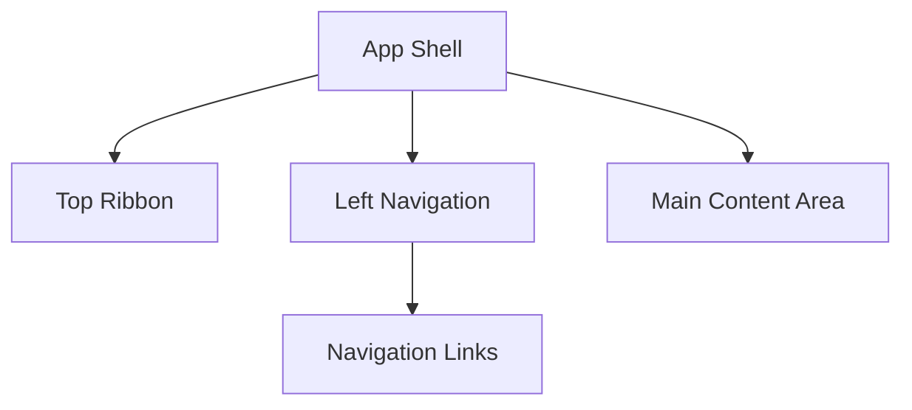
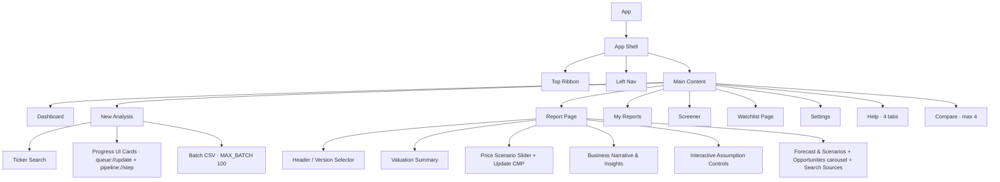

# UI/UX Design

This document outlines the UI/UX architecture, layout, design system, and component hierarchy for Stocksy, ensuring a modern, professional, and readable application.

## 1. App Shell Layout

The application utilizes a persistent navigation shell featuring a top ribbon for global actions and a left navigation sidebar. 

```text
+-------------------------------------------------------------------------+
| File           Settings                          Help                   |
|  Dashboard     LLM Provider                      User Guide & Help      |
|  My Reports    AI Agent Tools                                        |
|  Screener      Country Parameters   + Edit (Undo/Redo/Cut/Copy)         |
|  Watchlists    System Prompts                                           |
|  New Analysis  Database & Logging                                       |
|                Queue & Parallelism                                      |
|                Miscellaneous                                            |
+-------------+-----------------------------------------------------------+
| Dashboard   |                                                           |
| New Analysis|                     Main                                  |
| My Reports  |                    Content                                |
| Screener    |                     Area                                  |
| Watchlists  |                                                           |
+-------------+-----------------------------------------------------------+
```



## 2. Pages

### Dashboard Page
Provides a high-level overview of the user's workspace.
- **Quick Stats Overview:** Metrics such as total reports analyzed, reports per model, and total stock reports per country.
- **Recent Analyses Grid:** Visual cards for recently generated stock reports.
- **Watchlist Summary Card:** Quick glance at the performance and status of top watchlisted items.
*(Note: Ticker search is located strictly in the New Analysis page to keep the Dashboard clean.)*

### New Analysis Page
Initiates the valuation process. Users can trigger multiple stock analyses (either different stocks, or the same stock using different models) simultaneously and as a **batch CSV** (`ticker,country,provider` up to `MAX_BATCH 100`).
- **Controls:** Country selector (dropdown) to scope the search, ticker search bar (queries cached tickers via `ticker_search`), Yahoo on-demand `Search Yahoo` button, LLM provider/model indicator.
- **Feedback:** Selected stock info card, `Analyze` / `Analyze Batch` button with pending/active chips.
- **Progress UI:** Queue-stacked cards bound to `queue://update` + `pipeline://step` SSE: pipeline steps `Fetching Data → Validating → AI Analysis → Saving` (30%) + AI streaming tokens (70%) via `llm://token` (120s idle / 300s total, 1500ms backoff on stream error). Multiple cards appear concurrently up to `analysis.max_parallel` (1–5, see Settings → Queue & Parallelism). File fetch uses `PathBuf` to avoid holding `Connection` across `await`.
- **Failure path:** Yahoo `status != completed` or `<3` years returns ephemeral `RunAnalysisResult {status: "failure"}` (shown in queue, **not** inserted into `analysis_reports`); no manual-import popup — Yahoo is the sole source.

### Report Page
The core destination detailing the AI-driven valuation. Opens when a user selects a stock from the My Reports page or the Screener.
- **Header:** Company name, ticker, exchange, `country_code` text, sector/industry/currency, `price_date`, LLM provider/model badge, `is_primary` star, Favorite/Watchlist/Delete/PDF/Version pills, `Reanalyse` prefill.
- **Valuation Summary:** Weighted FV + Base/Bull/Bear, verdict badge, `gap%`, `risk_reward`, CMP (plus Base FV gap parity note — `cents(weighted/base)` lock via sensitivity scaling factor).
- **Price Scenario Slider:** Bear/Base/Bull diamonds + CMP diamond (rotated 45°) with bear/bull imagery and **Update CMP** (`updateCmp` live Yahoo price).
- **Business Description Narrative:** `extractBusinessDescription` markdown; **Historical Key Insights** bullets (`normalizeHistoricalBullets`).
- **Scenarios Panel:** Optimistic (25%) / Expected (55%) / Pessimistic (20%) cards from `scenarios` array.
- **Sensitivity Heatmap:** 3×3 WACC × Growth (`±0.5%`), base cell marked, stability flag `WACC - g ≤ 0.0001` or `|pct| > 1.0`.
- **Confidence Meter:** 5 bars (30/30/20/15/5 caps) + `overall_score/level` clamped via `engine::confidence`.
- **WACC Breakdown:** Ke/Kd + leverage table; **Forecast Charts:** historical revenue/op-income + FCF bars + 5-year forecast bars (`recharts`), revenue vs margin.
- **Interactive Assumption Controls:** 5-year growth/margins + `terminal_*` + `fcf_conversion_factor` / `financial_services_ni_factor` / `wacc` / `cyclicality_bps` inputs → **Recompute** (`recompute_local`) local-only with banner _"Edit controls then press Recompute — recomputes locally only, never persisted."_ + Reset.
- **Opportunities & Risks** carousel, **Search Sources** dedup list, **Compare** picker (max 4 `?ids=`) — all local; no `Check for Updates`/freshness button (freshness is implicit via same-model Yahoo deep-equality skip — `Update CMP` is the only live-price action).

### My Reports Page (`src/pages/reports`)
Filterable flat table of all generated reports (FTS5 report search is separate).
- **Filters:** `Filter by ticker or company…` (client-side).
- **Columns (code):** `"" | Company (ticker+name) | Sector | Verdict | Fair Value | Gap | Confidence | Current Price | ""` + `View` button; row click → `/report/:ticker`. `country_code` is shown as prefix, not a header; `price_date` / LLM `model` / `favorite` are not table columns (favorite is on the Report header).
- **No grouping, no in-page Compare** — grouping/compare lives on the **Report** page (`Compare` picker max 4 `?ids=`) and the dedicated `/compare` page (see below). FTS5 report search (`report_search_fts`) is available via `ticker_search` + FTS indexes.

### Screener Page (`src/pages/screener`)
Advanced screening and discovery over `is_primary=1` completed reports.
- **Filters (8 chips + presets):** Country / Sector / Market-Cap / Verdict / Gap bucket / Confidence bucket / Risk bucket / Growth bucket; built-in presets + custom save/load (`screenerPresets.ts`); URL-synced.
- **Charts (interactive → filter/report):** Gap histogram (click → `gapBucket`), Sector bar (→ `sector`), **Gap vs Confidence scatter** (click → report), plus price GAP/Risk radar (5 dims, multi-select). Table: multi-column Shift-sort, pagination 50, `Watchlist` + `View` actions.
- **No in-page Batch button** — batch is via **New Analysis → Batch CSV** (`MAX_BATCH 100`, `analysis.max_parallel` gated). Screener is discovery + drill-down, not a batch runner.

### Watchlist Page (`src/pages/watchlists`)
Manage custom lists: `watchlists` + `watchlist_items` (`notes`, `target_price`).
- **Left list → Right table:** Gap / Fair Value / Price / Verdict + enriched join to primary report + `currency_code` fallback from `country_parameters`.
- **Adding:** From Report page picker (Create & add) and from Screener row picker; notes/target edits inline; row click → report. Max-parallel gated batch is not here — watchlists are tracking only.

### Compare Page (`src/pages/compare`, extra)
Not in the original `04` hierarchy but required for **F6.11 self-comparison**: `?ids=` (max 4) sticky Parameter column (Weighted/Base/Optimistic/Pessimistic + DCF Y1-5). Similarly `src/pages/db-browser` (`DEV` only, `__DEV__` route) and Dashboard tokens/cost extras are code-only extensions.

### Dashboard Page (extras)
Beyond the spec's quick stats, the Dashboard shows per-model & per-country `BarChart`s, **Tokens & Estimated Cost per provider** (`pricing.rs:PROVIDER_PRICING` → `dashboard_stats` → `provider_stats` table, totals), and 5-col recent table. No ticker search (stays on New Analysis).

### Settings Page (`src/pages/settings`, 7 tabs via `TABS` `llm|tools|countries|prompts|data|analysis|appearance`)
- **LLM Provider (D1 4+1):** Anthropic / DeepSeek / OpenAI / Kimi / Custom — each `LlmProviderCard` (`base_url`, API key `secrets`, `Fetch ↻`, model dropdown, `Test connection`, `Save` per-card) + global `Active provider` select. **Advanced** (`llm.thinking_budget` default `20000`, `llm.temperature` `0.3`, `llm.max_tokens` `32000`, migrations `10000→20000` etc.).
- **AI Agent Tools** (replaces separate Web Search/Web Scrape): `search.active_provider` radio `Tavily (Recommended)` / `ScrapingDog`; `Tavily Search & Scrape` key + `search.tavily_search_url` + `scrape.tavily_extract_url`; `ScrapingDog` key + `search.scrapingdog_search_url` + `scrape.scrapingdog_scrape_url`; `search.max_results` (5), `search.exclude_extensions` (`[".pdf",".doc",".xls"]`). Bundled fallback: if active key missing, try the other and inject `_fallback_warning`. Always-on, no enable toggle (removed `search.enabled` doc claim).
- **Country Parameters:** `CountriesTab` interactive grid: double-click cell, `isDirty` + `Add Country`, `yahoo_ticker_suffix` / `reference_urls` links; `sector`/`industry` are per-report, not per-country.
- **System Prompts (6 modules, D9, fixed 1-6 order):** `1 role_and_abort_protocol`, `2 validation_and_search`, `3 growth_and_fcf`, `4 narrative_and_risks` (note doc order is 1,2,3,4,5,6 but code order is `role→validation→growth→confidence→narrative→json` via `prompts::ORDER` + `db::list_prompts CASE`; the canonical numbering in UI is `1.…6.` persisted via `ui.prompts_selected_key`). `Save` bumps `version`; **Restore defaults** per-prompt (reseed single row, `version=1`) beside Save; global `prompt_restore_all` also exists.
- **Database & Logging:** `DataTab` — `getDataInfo` path/size/row counts (`StatCard`s), `Backup/Restore .sbk` (`STOCKYBK` MessagePack, 7 tables, no `secrets`) via `save/open` native dialogs, `DebugLogsPanel` (100-file cap, `debug_log_dir/list/read/clear`).
- **Queue & Parallelism** (`analysis.max_parallel` 1–5, `lib.rs` clamp, `queue.rs` `try_dispatch` FIFO): `<select>` 1 sequential … 5 max + helper _Higher values run more analyses in parallel. Limited by LLM TPM/RPM and AI-tool quotas._ + **How it works** card + **Rate limits — what to watch** two-column card (`LLM providers`: Anthropic/Kimi/DeepSeek free 50–60 RPM 1–2, OpenAI Tier2+ 3 safe; `Custom local` 1/≤2; `AI tools`: Tavily free 1000/mo, ScrapingDog 100–200/mo).
- **Miscellaneous (Appearance):** `AppearanceTab` — _Light theme only — no dark mode_, `display.sidebar_collapsed` checkbox, `general.default_market` (US), `general.pdf_save_folder` (Browse/Reset → `dirs::download_dir()`). DCF Defaults are **not** in Settings — live read-only on **Help**.
- **Help Page — 4-Tab User Guide (`#/help?tab=` + `ui.help_active_tab`, `Sidebar` `HelpCircle` above Settings):** `overview` (What this app does), `setup` (Setup Instructions + provider Custom/Ollama table), `features` (Key Features incl. batch `MAX_BATCH 100`), `methodology` (DCF Methodology + `dcfDefaults()` 9 rows). Cost table _Ballpark cost — 100 reports_ (Sonnet 5.5 $8–11, DeepSeek v4 Pro $3–4, GPT-5-mini $3–5, Kimi 2.6 $7–9, Gemini 3.8 Flash $3–4, Qwen Flash $3–4, Local Free via Ollama/LM Studio/MLX) — second after methodology; neutral _Good reasoning_ tip.

## 3. Theme & Design System

Stocksy uses a modern, clean, light-mode design similar to professional desktop financial SaaS apps.

### Color Palette (Light Theme Only)
- **Background:** White/Light Gray (`#F8FAFC` or `#FFFFFF`)
- **Surface:** White (`#FFFFFF`) with subtle drop shadows
- **Border:** Light Gray (`#E2E8F0`)
- **Text Primary:** Dark (`#0F172A`)
- **Text Secondary:** Gray (`#64748B`)
- **Accent/Positive (Undervalued):** Emerald (`#10B981`)
- **Warning/Neutral (Fairly Valued):** Amber (`#F59E0B`)
- **Error/Negative (Overvalued):** Red (`#EF4444`)
- **Navigation Sidebar:** Subtle gray background (`#F1F5F9`)

## 4. Component Hierarchy



## 5. Queue & Parallelism UX (code, not a popup)

No manual-import popup — Yahoo is the sole source. When Yahoo returns `<3` years / non-positive price/mcap / 2-consecutive negative `operating_income`, `fetch.status` is `error_*` (or `<3` → `None` → `yahoo fetch failed …`) and the pipeline returns ephemeral `failure` (`Empty JSON …` / truncated-at-`max_tokens` / `HTTP 429` all map to queue `Failed` and debug log, not a DB row). Queue UI shows `pending/active/recent` (20) with `max_parallel` (1–5, default 1, `queue.rs:76` clamp). The former manual `TTM recomputation` edge case (F1.3) is covered inside `yahoo/transform.rs:149-160` (TTM first row + last-4-fiscal-years + `b.cmp(a)`) — not a user flow.

## 6. Feature Mapping

| Feature | ID | Component/Page |
|---------|---|----------------|
| Light Theme Default | F7.1 | Global App Shell, Theme System |
| Price Scenario Slider | F7.4 | Report Page |
| Interactive Assumption Controls (Recompute button, not instant) | F2.15 | Report Page (`recompute_local`, banner not persisted) |
| Screener Gap vs Confidence Scatter | F6.10 | Screener Page (histogram + sector + scatter + radar) |
| Single Stock Self-Comparison | F6.11 | Report Compare picker + `/compare?ids=` (max 4) — also accessible from My Reports drill-down |
| 4-Tab Help User Guide + Cost Table | F9.6 (Help) | Help Page (`help.tsx:9` overview/setup/features/methodology + 7-row cost table) |
| Queue & Parallelism Two-Column Rate-Limits Card | FC9 (Queue) | Settings → Queue & Parallelism (`settings/index.tsx:1584`) |
