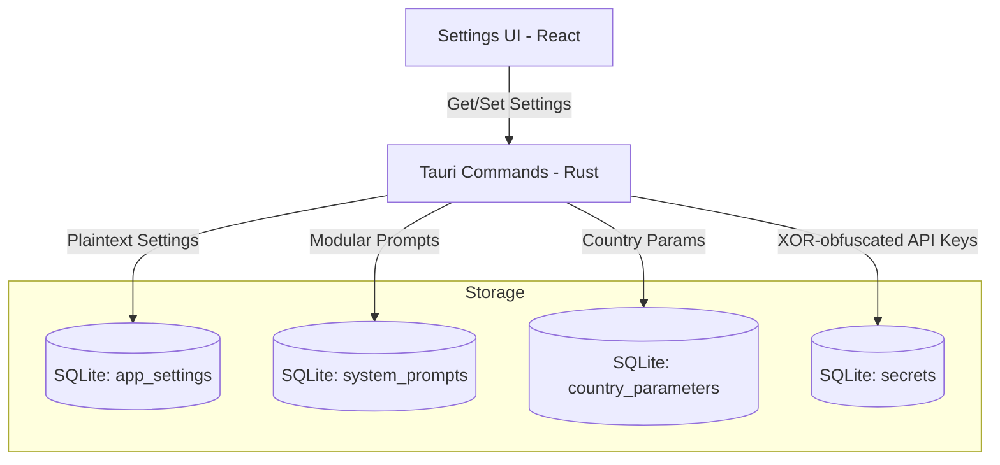

# Configuration Design: Stocksy Desktop

This document details the configuration and settings management architecture. It defines how user preferences, API keys, LLM configuration, and system prompts are stored and managed.

## Configuration Architecture

Settings are managed via a centralized configuration service in the Rust backend. Sensitive data (API keys) are stored in a dedicated `secrets` table in SQLite, obfuscated with a machine-derived XOR key. General settings and parameters are in the `app_settings` table.

## Design Principles

1. **Yahoo Finance (free)** — sole financial data source, no API key required. No data configuration category needed.
2. **Flexible LLM** — 4 standard cloud providers (Anthropic, DeepSeek, OpenAI, Kimi) plus 1 Custom endpoint. Configured separately, with one marked as the active default.
3. **Agentic AI with Tool Access** — LLM is given Tavily search/extract as tools.
4. **Tavily as Default** — `/search` + `/extract` from one API key covers both web search and content extraction.
5. **Modular Prompts, Single Shot Execution** — Prompts are stored and managed in the UI as distinct modules for ease of maintenance. The Rust backend concatenates them into a single comprehensive prompt at runtime.
6. **No DCF Defaults Config in Settings** — DCF calculations strictly follow mathematical formulas in Rust (D4); Settings does **not** host them. Formula constants are surfaced **read-only on the Help page** (`#/help` via `dcf_defaults()`), not as editable Settings. Country parameters remain the only macro-tunable inputs in Settings.
7. **Secure Credentials** — all API keys stored in a dedicated SQLite `secrets` table. Values are XOR-obfuscated with a machine-derived key (`stocksy-desktop:{HOME}:{USER}`, 256-byte repeating) and base64-encoded before writing. This prevents plaintext keys in the DB file without requiring an OS keychain or external crate. Security level: obfuscation (not cryptographic encryption). Module: `src-tauri/src/keyring_store.rs`.

---

## Settings Categories

Settings are stored in `app_settings` table as namespaced key-value pairs.

### Category: `llm` — LLM Provider Configuration (4+1 Structure)

The UI provides distinct configuration sections for the 4 standard providers plus 1 custom provider. Users can configure all of them simultaneously and mark one as the "default" (active) provider for analysis. All providers (even standard ones) expose a `base_url` parameter for future-proofing, allowing users to override the endpoint if API routes change.

| Key | Type | Default | Storage | Description |
| :--- | :--- | :--- | :--- | :--- |
| `llm.active_provider` | enum | `'anthropic'` | SQLite | The default provider used for analysis (`'anthropic'` \| `'deepseek'` \| `'openai'` \| `'kimi'` \| `'custom'`) |
| **Anthropic Config** | | | | |
| `llm.anthropic.api_key` | string | — | **secrets table** | API key for Anthropic |
| `llm.anthropic.base_url` | string | `https://api.anthropic.com` | SQLite | Pre-filled standard URL, editable for future-proofing |
| `llm.anthropic.model` | string | — | SQLite | Selected model (e.g., `claude-3-7-sonnet-20250219`) |
| **DeepSeek Config** | | | | |
| `llm.deepseek.api_key` | string | — | **secrets table** | API key for DeepSeek |
| `llm.deepseek.base_url` | string | `https://api.deepseek.com` | SQLite | Pre-filled standard URL, editable |
| `llm.deepseek.model` | string | — | SQLite | Selected model (e.g., `deepseek-reasoner`) |
| **OpenAI Config** | | | | |
| `llm.openai.api_key` | string | — | **secrets table** | API key for OpenAI |
| `llm.openai.base_url` | string | `https://api.openai.com` | SQLite | Pre-filled standard URL, editable |
| `llm.openai.model` | string | — | SQLite | Selected model (e.g., `gpt-4o`) |
| **Kimi Config** | | | | |
| `llm.kimi.api_key` | string | — | **secrets table** | API key for Kimi (Moonshot) |
| `llm.kimi.base_url` | string | `https://api.moonshot.ai/v1` | SQLite | Pre-filled standard URL, editable |
| `llm.kimi.model` | string | — | SQLite | Selected model (e.g., `moonshot-v1-auto`) |
| **Custom Config** | | | | |
| `llm.custom.api_key` | string | — | **secrets table** | API key (if required by local/remote custom endpoint) |
| `llm.custom.base_url` | string | — | SQLite | Base URL (e.g., `http://localhost:11434/v1`) |
| `llm.custom.model` | string | — | SQLite | Selected model |
| **Global Generation Settings** | | | | |
| `llm.thinking_budget` | integer | `20000` (was `10000` — `seeds.rs:476` migration) | SQLite | Extended thinking token budget (if supported by active provider). Must satisfy `thinking_budget < max_tokens` — pipeline clamps with ≥10_000 gap (`pipeline/mod.rs:724`) |
| `llm.temperature` | float | `0.3` (was `0.1`) | SQLite | Generation randomness (0-1); omitted for Kimi/DeepSeek/o1/o3/gpt-5+ per `openai_compat.rs:47` |
| `llm.max_tokens` | integer | `32000` (was `8192`) | SQLite | Maximum response tokens; pipeline uses `output_tokens == max_tokens` as truncation signal (`pipeline/mod.rs:983`) |

**UI Actions (Per Provider):**
- **Fetch Models** button → GET to the specific provider's API (using the configured `base_url`), populates that provider's model dropdown.
- **Set as Default** button → Updates `llm.active_provider` to this provider.
- **Test Connection** button → POST to chat endpoint to verify auth + response.

---

### Category: `search` + `scrape` + `analysis` + `general` + `display` + `ui` — AI Agent Tools & App State (always-on)

> **Architecture**: These keys + URLs configure the **bundled Tavily + ScrapingDog** tools made available to the LLM. Search/Extract are **always active** (no enable toggle) — the LLM autonomously calls `web_search`/`web_scrape`. `search.active_provider` (`tavily` | `scrapingdog`) selects the default; the other is the automatic fallback (with `_fallback_warning`). Provider URLs are persisted in `app_settings` for future-proofing; empty = hardcoded default. See `tools/mod.rs:52`, `seeds.rs:322`, `pipeline/mod.rs:620-681`.

| Key | Type | Default | Storage | Description |
| :--- | :--- | :--- | :--- | :--- |
| `search.tavily_key` | string | — | **secrets table** | Tavily API key (default) |
| `search.scrapingdog_key` | string | — | **secrets table** | ScrapingDog API key (bundled alternative) |
| `search.tavily_search_url` | string | `https://api.tavily.com/search` | SQLite | Tavily Search endpoint (editable) |
| `scrape.tavily_extract_url` | string | `https://api.tavily.com/extract` | SQLite | Tavily Extract endpoint (editable; `ai_query` ignored — always `query: "find forward estimates"`) |
| `search.scrapingdog_search_url` | string | `https://api.scrapingdog.com/google` | SQLite | ScrapingDog Search (Google) endpoint (editable) |
| `scrape.scrapingdog_scrape_url` | string | `https://api.scrapingdog.com/scrape` | SQLite | ScrapingDog Scrape endpoint (editable; `dynamic=true` + `ai_query`) |
| `search.active_provider` | enum | `tavily` | SQLite | `tavily` (recommended) \| `scrapingdog` — radio in AI Agent Tools tab |
| `search.max_results` | integer | `5` | SQLite | Max search results per tool call (`tools/tavily.rs` clamp 1-10) |
| `search.exclude_extensions` | JSON | `[".pdf",".doc",".xls"]` | SQLite | `web_scrape` gate — any `url` containing these (case-insensitive) is skipped with `{"error":"skipped document URL…"}` without network |
| `analysis.max_parallel` | integer | `1` (range `1–5`, clamp `queue.rs:76`) | SQLite | Queue concurrency — Settings → Queue & Parallelism `<select>` 1 sequential … 5 max; persisted + in-memory `QueueHandle` (`lib.rs:175`) |
| `general.default_market` | string | `US` | SQLite | Default country in New Analysis market selector (`appearance` tab) |
| `general.pdf_save_folder` | string | `""` → `dirs::download_dir()` backfill (`seeds.rs:465`) | SQLite | PDF save folder (Browse/Reset in Miscellaneous) |
| `display.sidebar_collapsed` | boolean | `false` | SQLite | Left nav collapsed |
| `display.window_width` | integer | `1400` | SQLite | Last window width (mirrors `tauri.conf.json:14`) |
| `display.window_height` | integer | `900` | SQLite | Last window height (mirrors `tauri.conf.json:15`) |
| `display.window_x` / `y` | integer | — (dynamic) | SQLite | Last window X/Y (not seeded; `db.rs:534` optional) |
| `ui.help_active_tab` | string | `overview` | SQLite | Help 4-tab persistence `help.tsx:7` (`overview|setup|features|methodology` + `?tab=` URL) |
| `ui.prompts_selected_key` | string | — (transient) | SQLite | System Prompts left-nav selection (`settings/index.tsx:1194`) — not seeded |

> **Removed / not seeded:** `search.brave_key` / `search.brave_search_url` (`https://api.search.brave.com/...`), `search.custom_provider_url` / `search.custom_provider_key` / `scrape.custom_provider_key` (former generic custom-provider slots) — replaced by the ScrapingDog pair above. Former `search.enabled` toggle was removed (always-on). Former `search.custom_provider_url` family is no longer in `SETTING_ROWS` (28 rows today — see `02:494` `seeds.rs:322`).

---

### Category: `ui` + remaining `display` — see table above (Help tab + Prompts selection).

Light theme only — no toggle. Window min size `960×640` (`tauri.conf.json:18`) not in DB.

---

## Country Parameters (`country_parameters` table)

Macroeconomic parameters are inherently tied to the active country.

**UI Paradigm:** Represented in the Settings UI as an interactive Data Grid (Excel-like).
- **Inline Editing:** Users can click into any cell (e.g., Risk-Free Rate, Tax Rate) to edit the data directly.
- **Add Row:** A button at the bottom of the grid allows users to insert a completely new country.

| Parameter | Description | Unit |
| :--- | :--- | :--- |
| `country_code` | Unique identifier | string (e.g., 'IN', 'US') |
| `expected_market_return` | Expected total market return | decimal (e.g., 0.16) |
| `risk_free_rate` | 10-year government bond yield | decimal (e.g., 0.07067) |
| *equity_risk_premium* | *Computed: expected_market_return - risk_free_rate* | *decimal (derived)* |
| `corporate_tax_rate` | Statutory corporate tax rate | decimal (e.g., 0.30) |
| `nominal_gdp_growth` | Nominal GDP growth rate | decimal (e.g., 0.1033) |
| `yahoo_ticker_suffix` | Suffix for Yahoo tickers | string (e.g., '.NS') |

---

## System Prompts (`system_prompts` table)

### Modular Storage, Single-Shot Execution

To ensure the prompt remains easy to manage and review, the application stores prompt logic as **distinct, modular fragments** within the database and UI.

**UI Management:** `Settings → System Prompts` shows the 6 modules in fixed numbered order `1. Role & Abort Protocol` → `2. Input Data, Tools & Search Strategy` → `3. Growth, FCF & WACC Inputs` → `4. Narrative & Risks` → `5. Confidence Scoring` → `6. Structured JSON Output Schema` (left nav `1. … 6.` + `prompt_key · vN`). Clicking a module loads its `prompt_text` in the editor. Selection is persisted via `app_settings.ui.prompts_selected_key` so navigating away and back restores the same module, and `list_prompts` uses `CASE` ordering (not alphabetical).

**Actions:** `Save prompt` bumps `version` and `updated_at` and refetches the list so edits survive tab switches. **Restore defaults** (beside Save) reseeds the selected row from `seeds::PROMPT_ROWS` (`UPDATE … SET prompt_text/name/description = seed, version=1, is_active=1` via `prompt_restore_default`); a global reseed is available via `prompt_restore_all`/`seed_prompts(force=true)`.

**Runtime Compilation:** When an analysis is triggered, the Rust backend queries all active modules **in the fixed 1-6 order** (`src-tauri/src/prompts/mod.rs:ORDER` + `db::list_prompts CASE`), concatenates with `\n\n---\n\n`, and sends as a single system prompt to the LLM.

**Prompt Modules (authoritative 1-6):**
1. `role_and_abort_protocol`: ValorBot identity + critical abort rules.
2. `validation_and_search`: Input JSON validation + `web_search`/`web_scrape` tool rules + country-specific search guidance.
3. `growth_and_fcf`: Revenue/margin projections (Y1-2 consensus → Y3-5 GDP convergence), terminal inputs with mandatory cliff checks, FCF conversion & cyclicality.
4. `narrative_and_risks`: Business context, historical insights (single string), growth/terminal rationale, scenario_narratives (qualitative 1-sentence per scenario), opportunities/risks, investment perspective.
5. `confidence_scoring`: 5-dimension rubric (caps 30/30/20/15/5, evidence required).
6. `json_schema`: Strict single-JSON output format (rates as decimals, `historical_performance_insights` as string, `overall_score` = sum of dimensions).

*(Note: The default prompt modules were adapted from the existing n8n web app and reordered per user approval to suit the local DCF split.)*

---

## Feature Mapping

| Feature ID | Feature | Configuration |
| :--- | :--- | :--- |
| **F9.1** | Global Settings State & UI | All Settings UI tabs |
| **F9.2** | Secure API Key Storage | SQLite `secrets` table (XOR-obfuscated, `keyring_store.rs`) — covers all `llm.*_key`, `search.*_key`, `scrape.*_key` values |
| **F9.3** | LLM Configuration | `llm.*` settings (4+1 explicit configs: Anthropic/DeepSeek/OpenAI/Kimi/Custom) |
| **F9.5** | AI Agent Tools (Bundled Tavily + ScrapingDog, always-on) | `search.*` + `scrape.*` + `analysis.max_parallel` (see table) — no enable toggle |
| **F9.6** | Country Parameters Editor | Data Grid UI interacting with `country_parameters` + `yahoo_ticker_suffix`/`reference_urls` |
| **F9.7** | Appearance Config | `display.*` settings (light only) |
| **F9.8** | Data Management | DB path/size/counts + `.sbk` backup/restore + debug logs (see `02:7`); no `clear cache` |
| **F9.9** | System Prompt Editor | Modular UI mapping to `system_prompts` table (6 modules, D9, versions `2→3→5` via `seeds.rs:405-450`) |
| **Queue** | Queue & Parallelism | `analysis.max_parallel` + **Rate limits — what to watch** two-column card (see `04`) |
| **F9.6 (alt)** | DCF Defaults (Help, read-only, D4) | **Help 4-tab User Guide** (`#/help?tab=` + `ui.help_active_tab`) — `methodology` tab hosts `dcf_defaults()` (9 rows) + Cost table _Ballpark cost — 100 reports_ (7 rows) |
