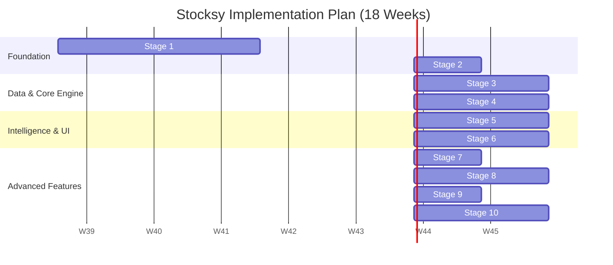
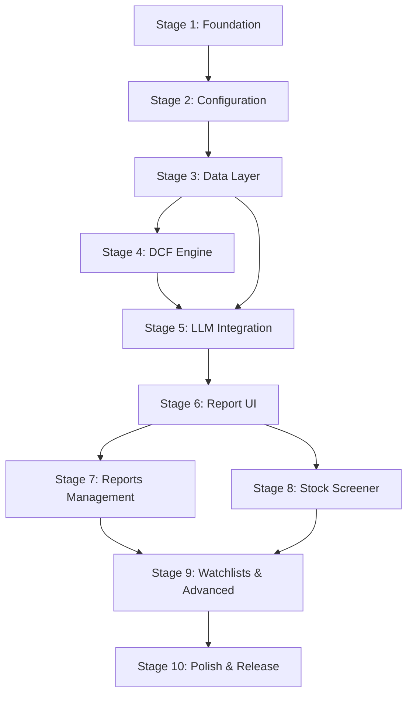

# 06 Implementation Stages

This document outlines the structured rollout of the Stocksy application across 10 stages spanning 18 weeks. The roadmap ensures continuous validation of core systems before layering on complex features, fully aligning with the approved 88-feature list.

## Implementation Timeline

## Stage Dependencies

## Stage Breakdown

### Stage 1: Foundation (Weeks 1-3)
Establish the underlying application architecture, database, and basic user interface shell.
*   **Target Features:** `F8.1`, `F5.1`, `F5.2`, `F7.1`, `F7.2`, `F7.3`, `F7.15`
*   **Milestone:** Tauri v2 project running with SQLite database established, React frontend shell with routing and light theme functional.

### Stage 2: Configuration & Settings (Week 4)
Build the central configuration management, API key storage, and settings UI.
*   **Target Features:** `F9.1`, `F9.2`, `F9.3`, `F9.4`, `F9.5`, `F9.7`, `F9.8`, `F9.9`, `F8.2` (+ `F9.6` read-only on **Help**, not Settings, per D4)
*   **Milestone:** All settings categories (LLM 4+1, AI Tools always-on, Country Params, System Prompts, Appearance, Data) functional; `F9.6` DCF defaults surfaced read-only on Help (`#/help`); API keys XOR-obfuscated in SQLite `secrets` table (D2), non-secret settings persisted in `app_settings`.

### Stage 3: Data Layer (Weeks 5-6)
Implement the core financial data fetching from Yahoo Finance and initial caching systems.
*   **Target Features:** `F1.1`, `F1.2`, `F1.4`, `F1.5`, `F1.6`, `F1.9`, `F5.5`
*   **Milestone:** Ability to fetch and cache historical data, fundamentals, and ticker metadata directly from Yahoo Finance APIs based on multi-country configuration.

### Stage 4: DCF Core Engine (Weeks 7-8)
Build out the mathematical valuation models in the Rust backend.
*   **Target Features:** `F2.1` through `F2.14`
*   **Milestone:** Complete, testable Rust implementation of the Free Cash Flow models, WACC calculation, terminal value modeling, and DCF calculation engine returning accurate valuation ranges.

### Stage 5: LLM Integration (Weeks 9-10) + v2 Patch
Construct the AI pipeline handling search, web scraping, prompting, and JSON generation. **v2 patch** adds bull/bear persistence and confidence fix.
*   **Target Features:** `F3.1` through `F3.8`, `F4.1`, `F4.2`, `F4.4`, `F5.3`, `F5.4`
*   **Milestone:** End-to-end agentic pipeline (tool-calling loop, 10 turns) with correct provider harness routing (`custom` → `openai_compat`), debug JSONL logs, and `SCHEMA_002` (`bull_case_fair_value`/`bear_case_fair_value`, fixed `confidence_score/level` from clamped dimensions).
*   **v2 Prompt Patch:** Enforced 1-6 order (`role → validation → growth → narrative → confidence → json`), `CASE` ordering in `list_prompts`/`stitch`, `ui.prompts_selected_key` persistence, refetch-after-save, per-prompt **Restore defaults** (reseed single row).

### Stage 6: Report Visualization (Weeks 11-12)
Develop the primary user interface for viewing a completed stock analysis.
*   **Target Features:** `F7.4`, `F7.5`, `F7.6`, `F7.7`, `F7.8`, `F7.9`, `F7.12`, `F2.15`, `F2.16`
*   **Milestone:** A rich, interactive React view displaying the DCF inputs, resulting valuation ranges, AI narratives, and confidence scores.

### Stage 7: Reports Management & Comparison (Week 13)
Implement features to manage generated reports over time.
*   **Target Features:** `F5.3`, `F5.4`, `F5.7`, `F5.8`, `F6.11`
*   **Milestone:** 'My Reports' list view, report versioning, ability to compare a company's historical reports against itself, and import/export functionality.

### Stage 8: Stock Screener (Weeks 14-15)
Build out the bulk analysis and filtering capabilities.
*   **Target Features:** `F6.1` through `F6.7`, `F6.10`, `F6.13`
*   **Milestone:** Ability to run batch stock analyses, view them in an interactive data grid, filter based on calculated metrics (e.g., Margin of Safety), and manage screener presets.

### Stage 9: Watchlists & Advanced (Week 16)
Layer on portfolio tracking and advanced report generation tools.
*   **Target Features:** `F6.12`, `F6.8`, `F7.13`, `F7.16`
*   **Milestone:** Functional watchlists pulling latest prices to compare against saved intrinsic values, PDF report generation, and visual radar charts for confidence scores.

### Stage 10: Polish & Release (Weeks 17-18)
Finalize error handling and build pipelines. **Removals from original plan are marked below** (no code was added for them — their design has been pruned per `01`):
*   **Target Features (remaining):** `F1.3` TTM edge cases (inside `yahoo/transform.rs`, not a user flow), `F4.5` source citations, `F4.6` document filter (`search.exclude_extensions`), `F5.9` backup (.sbk), `F8.3` window persistence, `F8.4` desktop notifications (tray/notify shell), plus remaining P1/P2.
*   **Removed from Stage 10 scope:** `F1.7` Manual Data Input popup + JSON import — **Removed** (Yahoo sole source); `F4.3` Brave search — **replaced by ScrapingDog** (bundled); `F4.7` generic Custom provider — **replaced by ScrapingDog**; `F8.5` Auto-updater / `Check for Updates` — **Removed** (no updater plugin); if any of these are desired later they need a new stage.
*   **Milestone:** Robust retry/rate-limit handling (streaming 120s idle / 1500ms backoff, 429/507 fail-fast), fallback Tavily↔ScrapingDog, queue `analysis.max_parallel` 1–5, JSON repair pipeline (5-candidate sanitizer + coalesce), and finalized cross-platform builds via CI. No updater, no manual fallback, no Brave/Jina code remains.

## Feature Distribution Summary

| Stage | Focus | Allocated Features |
| :--- | :--- | :--- |
| **1** | Foundation | F8.1, F5.1, F5.2, F7.1, F7.2, F7.3, F7.15 |
| **2** | Settings (+ Help DCF) | F9.1-F9.5, F9.7-F9.9, F8.2 + F9.6 on Help (D4) |
| **3** | Data Layer | F1.1, F1.2, F1.4, F1.5, F1.6, F1.9, F5.5 |
| **4** | DCF Engine | F2.1-F2.14 |
| **5** | LLM Pipeline | F3.1-F3.8, F4.1, F4.2, F4.4, F5.3, F5.4 |
| **6** | Report UI | F7.4-F7.9, F7.12, F2.15, F2.16 |
| **7** | Reports Mgmt | F5.3, F5.4, F5.7, F5.8, F6.11 |
| **8** | Screener | F6.1-F6.7, F6.10, F6.13 |
| **9** | Watchlists & Advanced | F6.12, F6.8, F7.13, F7.16 |
| **10** | Polish & Release | F1.3, F4.5, F4.6, F5.9, F8.3-F8.4 (plus queue/ retry/ JSON-repair) — **Removed:** F1.7 manual, F4.3 Brave, F4.7 generic custom, F8.5 updater (no code) |

*Note: All removed features (e.g., F6.9, F6.14, F7.10, F7.11, F7.14, F7.17, IndianAPI integration) are entirely excluded from this timeline.*
